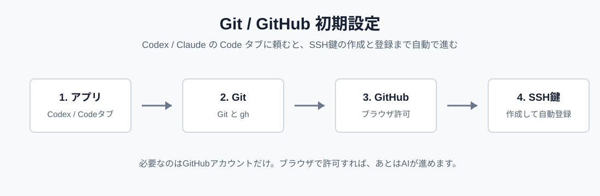

# Coding Agent 用 Git / GitHub 初期設定ガイド

非技術者が Codex や Claude Desktop の `Code` タブにそのまま頼める、短いプロンプト集です。

まっさらなPCを前提にしています。まずデスクトップアプリを入れて、そのあと GitHub のSSH鍵を設定します。

## ガイド

| OS | 日本語 | 中文 |
| --- | --- | --- |
| Mac | [mac-ja.md](mac-ja.md) | [mac-zh.md](mac-zh.md) |
| Windows | [windows-ja.md](windows-ja.md) | [windows-zh.md](windows-zh.md) |

## 使い方

1. 自分のOSと言語のページを開く
2. Codex または Claude Desktop を入れる（Windows は Git for Windows も）
3. ページ内のプロンプトをそのままコピーする（書き換え不要）
4. Codex、または Claude Desktop の `Code` タブに貼る
5. AIの質問（名前・メール）に答える
6. ブラウザで認証コードを入れて GitHub を許可する

SSH鍵の作成と GitHub への登録は、`gh`（GitHub CLI）が自動で行います。公開鍵のコピペは不要です。

## 公式リンク

- [Codex - Get started](https://openai.com/codex/get-started/)
- [Claude Desktop - Install](https://support.anthropic.com/en/articles/10065433-installing-claude-for-desktop)
- [Claude Code Desktop](https://code.claude.com/docs/en/desktop)
- [Git - Downloads](https://git-scm.com/downloads)
- [GitHub CLI - gh auth login](https://cli.github.com/manual/gh_auth_login)
- [GitHub CLI - Install](https://github.com/cli/cli#installation)
- [GitHub Docs - Generating a new SSH key](https://docs.github.com/en/authentication/connecting-to-github-with-ssh/generating-a-new-ssh-key-and-adding-it-to-the-ssh-agent)
- [GitHub Docs - Adding a new SSH key](https://docs.github.com/en/authentication/connecting-to-github-with-ssh/adding-a-new-ssh-key-to-your-github-account)
